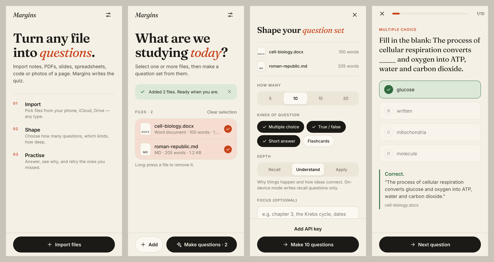
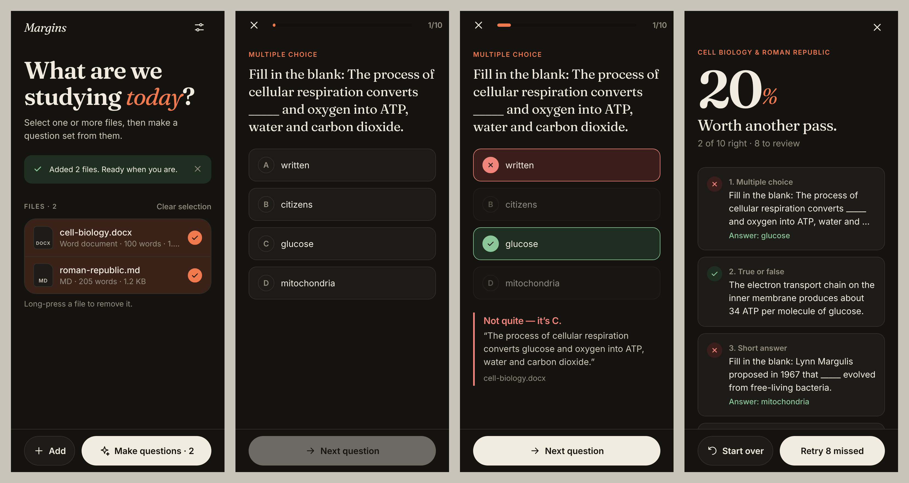

# Margins

A mobile app (iOS, Android and web) that turns **any file** on your device into a study quiz.
Import notes, PDFs, slides, spreadsheets, e-books, code, or photos of a page. Pick how many questions,
which kinds, and how deep they go. Then practise: answer, see why, and retry the ones you missed.




## Features

- **Import any file type** from the system file picker (Files, iCloud Drive, Google Drive, Downloads…), several at a time.
- **Four question kinds:** multiple choice, true/false, short answer (self-marked against a model answer) and flashcards.
- **Three depths:** Recall (facts), Understand (relationships) and Apply (new scenarios).
- **Optional focus**, for example "chapter 3" or "dates only".
- **Mix files:** select several files and build one question set from all of them.
- **Results and retry:** see your score, review each question, and retry only the ones you missed.
- **Two engines**
  - **Claude** (`claude-opus-5-5`): reads PDFs and images natively, writes explanations and deeper questions. Uses your own Anthropic API key.
  - **On-device:** no key and no network. Builds fill-in-the-blank, true/false and flashcard questions from the most information-dense sentences. Works with text-based files only.
- Light and dark themes, haptics, screen-reader labels, and touch targets of at least 44pt.

## How files are read

| File | What happens |
| --- | --- |
| PDF | Sent as-is; Claude reads text, tables and figures (≤ 20 MB) |
| PNG / JPG / GIF / WebP | Sent as-is; Claude reads the image (≤ 5 MB) |
| DOCX, PPTX, XLSX, ODT/ODP/ODS, EPUB, Pages | Unzipped and converted to plain text |
| HTML, RTF | Markup stripped |
| TXT, MD, CSV, JSON, code, subtitles, logs… | Decoded as text |
| Anything else | Sniffed: text in disguise is decoded; true binaries fall back to their readable strings |

All of this lives in [`src/lib/extract.ts`](src/lib/extract.ts).

## Privacy

Files are stored only on the device. In Claude mode, a file goes straight from the phone to the Anthropic API when you make questions, and to no other server. The API key is kept in the iOS Keychain / Android Keystore (`expo-secure-store`). On web it is kept in browser storage.

## Run it

```bash
cd question-forge
npm install
npx expo start          # scan the QR code with Expo Go, or press i / a / w
```

Then open **Settings** (the sliders icon), paste an Anthropic API key from
[console.anthropic.com](https://console.anthropic.com/settings/keys), and import a file.
If you skip the key, the app uses on-device mode.

```bash
npm run typecheck       # tsc --noEmit
npm test                # extraction + offline generator unit tests
npx expo export -p web  # static web build
```

## Structure

```
src/app/            Expo Router screens
  index.tsx         Library: import, select files, past question sets
  generate.tsx      Shape the set (count, kinds, depth, focus) and generate
  quiz/[id].tsx     Player + results / retry missed
  settings.tsx      Engine and API key
src/lib/
  extract.ts        Any file -> text or native bytes
  generateClaude.ts Claude structured-output generation
  generateOffline.ts On-device heuristic generator
  store.tsx         Library state (AsyncStorage) + payloads (file system / IndexedDB)
src/ui/             Design tokens, icons, primitives
```

Built with Expo SDK 58, React Native 0.88, Expo Router, and the Anthropic TypeScript SDK.
